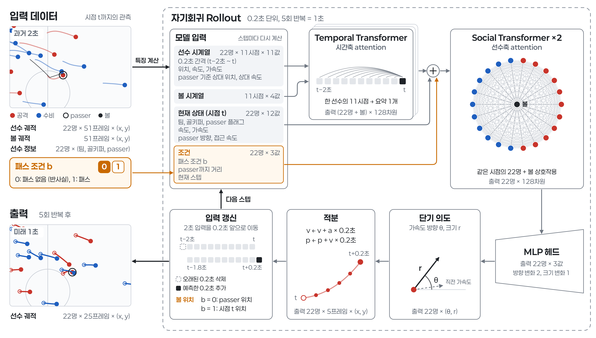

# 의도 기반 반사실 궤적 생성 (PAUSA 후속 연구)

PAUSA는 패스 타이밍을 평가할 때 패스가 없었을 경우의 1초 궤적, 즉 반사실(counterfactual) 궤적이 필요하고, 이를 등속 가정으로 생성합니다.
이 폴더는 등속 가정을 선수별 단기 의도를 예측하는 학습 기반 모델(Ours)로 대체합니다.



## 모델

- **입력:** 22명과 볼의 과거 2초 궤적, 패스 조건 b (1: 패스, 0: 패스 없음)
- **출력:** 22명의 미래 1초 궤적 (25 Hz)
- **생성:** Temporal Transformer가 선수별 시계열을, Social Transformer가 22명과 볼의 상호작용을 인코딩합니다. MLP 헤드가 선수별 단기 의도(가속도 방향, 크기)를 예측하고, 이를 적분해 0.2초 이동합니다. 예측 위치를 입력에 붙여 이 과정을 5회 반복합니다.
- **반사실 생성:** 패스 장면의 과거 궤적에 b=0을 조건으로 줍니다. 볼 위치는 passer 위치와 동일하게 둡니다.
- **passer:** 슬롯 0에 두고 플래그로 표시합니다. 다른 선수의 상대 좌표 기준이 되며, 네트워크는 다른 선수와 공유합니다.

단기 의도 표현은 IAD(Intention-Aware Diffusion, AAAI 2026)를 따릅니다. IAD는 의도를 먼저 예측해 궤적을 생성하는 보행자 궤적 예측 모델입니다.

## 폴더 구성

| 폴더 | 파일 | 역할 |
|---|---|---|
| `dataset/` | `build_dataset.py` | DFL 7경기에서 장면 샘플 생성 (과거 2초, 미래 1초, 25 Hz) |
| `models/` | `ours.py` | Ours 모델 |
| | `iad.py` | 1차 실험: IAD를 22명 축구 장면에 적용한 모델 |
| `training/` | `train_ours.py` | Ours 학습과 시험 경기 예측 |
| | `train_iad.py` | 1차 실험 학습 |
| `evaluation/` | `harness.py` | 등속 기준선과 공통 평가 |
| | `report_split.py` | 장면, 선수별 ADE / FDE 표 |
| | `report_ours.py`, `report_iad.py` | 실험별 보고서 |
| `visualization/` | `animate_three_panel.py` | 실제 궤적, PAUSA, Ours 3판 비교 영상 |
| | `animate_exp.py`, `animate_scene.py` | 실험별 장면 영상 |
| `assets/` | `ours_structure.png` | 구조도 |

ADE는 전 구간 평균 위치 오차, FDE는 마지막 시점 위치 오차입니다.

## 데이터 분할

DFL 공개 7경기를 씁니다.

| 분할 | 경기 |
|---|---|
| 학습 | 5경기 |
| 검증 | `DFL-MAT-J03WR9` |
| 시험 | `DFL-MAT-J03WN1` (보훔–레버쿠젠) |

## 실행

레포 루트에서 실행합니다. ELASTIC 동기화 데이터 준비는 [루트 README](../README.md)를 따르고, PyTorch가 추가로 필요합니다.

```bash
python intent_gen/dataset/build_dataset.py --data_dir ./data/dfl/elastic --out_dir ./data/dfl/intent_gen/samples
python intent_gen/training/train_ours.py --run expD_lean_s0 --feat rel_lean --weighted --ar --bb_only
python intent_gen/evaluation/report_split.py --runs Ours:expD_lean_s0
python intent_gen/visualization/animate_three_panel.py --run expD_lean_s0 --n 100
```

샘플, 가중치, 영상은 `data/dfl/intent_gen/`에 저장되며 깃에는 포함되지 않습니다.

진행 중인 연구입니다.
